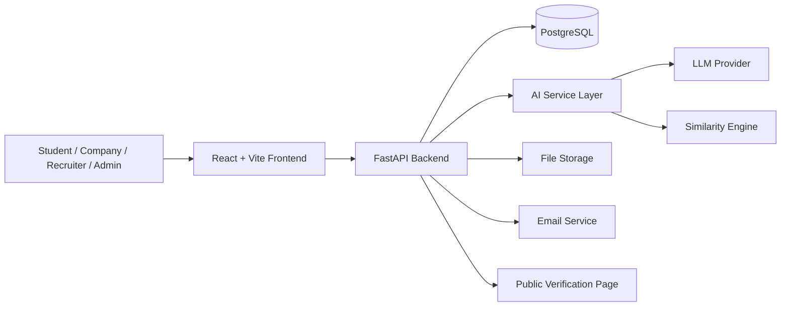
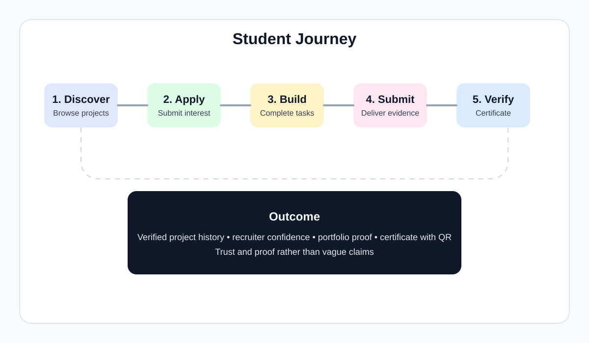
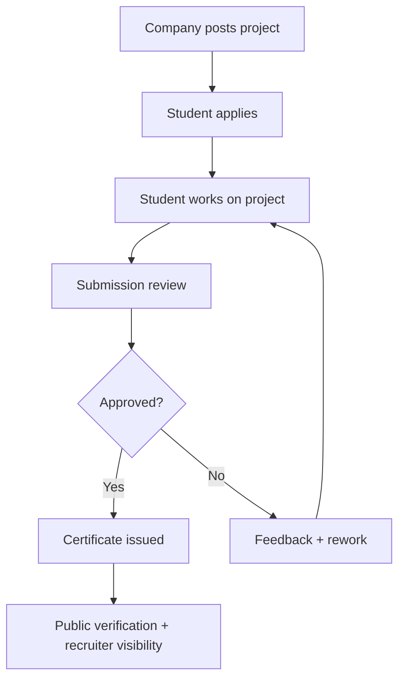
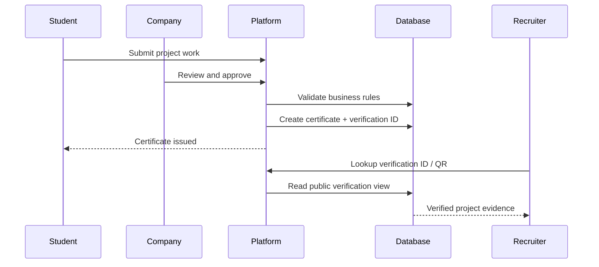

# ProjectProof AI

<p align="center">
  
</p>

ProjectProof AI is a verified project-experience platform that connects companies, students, and recruiters through real-world project work, AI-assisted evaluation, and trusted certificate verification.

It is designed as a practical proof-of-concept for a future product where approved companies post real projects, students complete them, and recruiters validate outcomes through verifiable project records.

## Why this project matters

Most student portfolios are static, disconnected, and difficult to verify. ProjectProof AI solves that by creating a structured workflow:

- companies publish authentic project briefs
- students complete real work and submit evidence
- reviewers evaluate outcomes against a transparent rubric
- certificates and verification IDs are generated for valid work
- public verification pages confirm authenticity without relying on screenshots or untrusted claims

This turns project participation into a credible, portfolio-ready signal rather than a vague list of coursework.

---

## Product overview

ProjectProof AI is built around a simple principle: trust must be verifiable.

The platform supports:

- student profiles and project portfolios
- company-led project publishing and review
- application workflows and submissions
- evaluation and certification
- recruiter visibility into verified public profiles
- AI-assisted assessment and recommendation features
- project traceability for proof and accountability

## Architecture at a glance



## User roles and workflows

### Student
- create and manage profile
- browse approved projects
- submit project applications
- upload evidence and deliverables
- track progress and badges
- receive certificates for approved work

### Company
- publish real projects and requirements
- review applications
- evaluate submissions
- approve or reject work
- issue certificates and project outcomes

### Recruiter
- view public verified profiles
- review student project evidence
- assess project quality through trust signals and certificates

### Admin
- approve company accounts
- monitor trust and platform health
- manage account activity and compliance
- handle platform-level governance

---

## Core features

### 1. Verified project records
Project outcomes are backed by a persistent, auditable trail rather than ad-hoc portfolio text. Certificates are issued in a controlled transaction and can be validated publicly.

### 2. Public verification
Each certificate includes a verification ID and QR-based public lookup. Recruiters can confirm authenticity without relying on screenshots or untrusted claims.

### 3. AI-assisted project support
The AI layer supports:
- resume and project analysis
- recommendation logic
- skill-gap assessment
- similarity checks
- project matching and internal assistance

All AI output is validated behind a single layer and logged for auditability.

### 4. Trusted review workflow
The evaluation process includes structured business rules, role-based authorization, and immutable audit records.

### 5. Security-first design
The system is designed around database integrity, server-side validation, privacy controls, and audit logging.

---

## Business flow

<p align="center">
  
</p>



## Certificate and verification flow



## System architecture diagram

<p align="center">
  
</p>

## Tech stack

| Layer | Technology | Purpose |
|---|---|---|
| Frontend | React + TypeScript + Vite | User-facing app with a modern SPA architecture |
| Styling | Tailwind CSS | Consistent design system and rapid UI implementation |
| Backend | Python + FastAPI | API, business logic, auth, and integrations |
| ORM & migrations | SQLAlchemy + Alembic | Data modeling and schema evolution |
| Validation | Pydantic | Request validation and AI-safe responses |
| Database | PostgreSQL | Relational data model with integrity rules |
| Auth | JWT + secure server-side validation | Access control and session management |
| PDF & certificates | WeasyPrint + QR generation | PDF certificate rendering and verification assets |
| AI | Provider-agnostic LLM client | AI analysis, recommendations, and matching |
| Testing | pytest + Vitest + Playwright | Backend, frontend, and end-to-end quality checks |
| Deployment | Docker + Docker Compose | Consistent local execution and demo readiness |

## Repository structure

```text
ProjectProof-Ai/
├── AGENTS.md
├── DESIGN.md
├── README.md
├── docker-compose.yml
├── schema.sql
├── .env.example
├── .gitignore
├── docs/
│   ├── 00-README.md
│   ├── 01-product-requirements.md
│   ├── 02-database-schema.md
│   ├── 03-tech-stack-and-architecture.md
│   ├── 04-api-specification.md
│   ├── 05-workflows-and-state-machines.md
│   ├── 06-ai-modules-specification.md
│   ├── 07-security-and-privacy.md
│   ├── 08-test-plan.md
│   ├── 09-project-plan-and-demo.md
│   ├── 10-college-report-pack.md
│   ├── 11-traceability-and-changes.md
│   └── 12-phase8-demo-runbook.md
├── backend/
│   ├── app/
│   ├── migrations/
│   ├── tests/
│   ├── pyproject.toml
│   ├── alembic.ini
│   └── Dockerfile
├── frontend/
│   ├── src/
│   ���── tests/
│   ├── package.json
│   ├── vite.config.ts
│   ├── playwright.config.ts
│   └── Dockerfile
├── ops/
├── assets/
│   ├── architecture-overview.svg
│   ├── student-journey.svg
│   └── certificate-verification.svg
└── .github/
```

## Getting started

### Prerequisites

- Docker and Docker Compose
- Node.js 18+
- Python 3.12+
- PostgreSQL 14+

### 1. Clone the repository

```bash
git clone https://github.com/Simaaqmoideen/ProjectProof-Ai.git
cd ProjectProof-Ai
```

### 2. Configure environment

```bash
cp .env.example .env
```

### 3. Start the app

```bash
docker compose up --build
```

### 4. Run backend locally (optional advanced setup)

```bash
cd backend
alembic upgrade head
python -m app.scripts.seed
uvicorn app.main:app --reload
```

### 5. Run frontend locally (optional advanced setup)

```bash
cd frontend
npm install
npm run dev
```

## Default local URLs

- Frontend: http://localhost:5173
- API: http://localhost:8000
- API health: http://localhost:8000/api/v1/health

## Environment configuration

The application expects environment variables such as:

```env
DATABASE_URL=postgresql+psycopg://postgres:postgres@db:5432/projectproof
JWT_SECRET=change-me-to-a-long-random-string
LLM_PROVIDER=
LLM_API_KEY=
LLM_DAILY_LIMIT_PER_USER=20
SMTP_URL=
```

## Key data and rules

The project is built around a number of important business constraints documented in `docs/01-product-requirements.md` and `docs/02-database-schema.md`:

- public verification pages read live data
- company and recruiter access is role-based
- student profiles remain private by default
- certificates are created in a single controlled transaction
- AI outputs are validated and never trusted blindly
- audit logs are generated for administrative changes

## Testing strategy

The project includes a structured testing approach across multiple layers:

- backend tests for API and domain logic
- database integrity checks
- frontend validation tests
- Playwright end-to-end coverage
- product-level requirements traceability across specification and tests

Example commands:

```bash
cd backend && pytest
cd frontend && npm test
npx playwright test
```

## Security and privacy focus

This project intentionally incorporates privacy and integrity controls:

- JWT auth with secure token flow
- server-owned business rules
- parameterized database queries only
- audit logging for administrative changes
- public verification without exposing sensitive data
- AI and file handling behind a constrained service layer

## Project status

This repository is currently structured as a proof-of-concept / project prototype with a full documentation backbone and architecture plan. It is intended to support validation, demo delivery, and future product development.

## Demo and reporting

The repository includes a demo-focused documentation set in `docs/` to support:

- project roadmap
- stakeholder presentation
- college report writing
- test validation
- demo runbook and final presentation flow

## Contribution guidelines

1. Read `AGENTS.md` first.
2. Follow the requirement IDs in `docs/01-product-requirements.md`.
3. Keep changes small and reviewable.
4. Add tests alongside feature changes.
5. Respect the design system in `DESIGN.md` for UI work.

## License

This project is maintained for academic and project-demo use. Apply or update the license as needed for your environment.

## Acknowledgements

This project was designed as a full-stack proof-of-concept combining:

- web application development
- backend API architecture
- database design
- verification workflows
- AI-assisted analysis
- product documentation and presentation artifacts

---

<p align="center">
  <b>ProjectProof AI</b><br>
  Verified project experience for students, companies, and recruiters.
</p>
