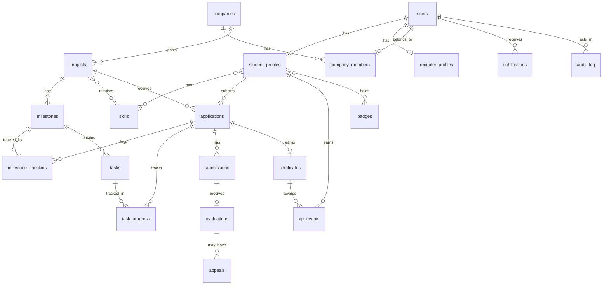

# ProjectProof AI: Database Schema

Database: PostgreSQL 14 or newer. The runnable file is `schema.sql` in this folder (version 2). It was loaded into PostgreSQL 16 and its integrity rules were tested (see section 6). This document explains what each part is for.

## 1. How to create the database

```bash
createdb projectproof
psql "$DATABASE_URL" -f schema.sql
```

For the real project, convert the file into Alembic migrations (see 03-tech-stack-and-architecture.md) so every change is versioned. Keep the same table and column names.

## 2. Entity relationship diagram



## 3. Tables by area

### Identity and access
| Table | Purpose | Key points |
|---|---|---|
| `users` | One row per account | `email` is case-insensitive and unique; `role` is student, company, recruiter or admin; password stored only as a hash |
| `refresh_tokens` | Long-lived login tokens | Only a hash of the token is stored; rows can be revoked |
| `student_profiles` | Student details | `is_public` defaults to false; `show_full_name_on_verification` controls name or initials; `resume_parsed` holds accepted AI-extracted data; `github_summary` and `github_analyzed_at` hold the accepted GitHub analysis (v2) |
| `companies` | Company records | `status` is pending, approved, rejected or suspended; `trust_score` 0 to 100; a partial unique index blocks a second active company on the same email domain |
| `company_members` | Links company users to a company | One company per user; roles owner and reviewer |
| `recruiter_profiles` | Recruiter details | Needs admin approval before searching |

### Skills
| Table | Purpose |
|---|---|
| `skills` | Master list of skills (case-insensitive names) |
| `student_skills` | A student's skills with proficiency 1 to 5 and a source: self, resume or verified_project |
| `project_skills` | Skills a project requires |

### Projects and work
| Table | Purpose | Key points |
|---|---|---|
| `projects` | A company's project | `xp_max` is computed by the server, never typed by a company; `ai_generated` records whether the AI brief was used; `removed_by`, `removed_at` and `removal_reason` record an admin removal, and a check constraint requires all of them together with status `removed` |
| `milestones` | Ordered steps of a project | `due_day_offset` counts days from the student's start date |
| `tasks` | Tasks inside a milestone (v2) | `application_id` empty means the company defined it for every student; set means a personal sub-task of that one application |
| `task_progress` | A student's status on each task (v2) | `todo`, `in_progress` or `done`; `completed_at` is required exactly when `done`; a trigger stops one application tracking another application's personal task |
| `applications` | A student's application and, once selected, their work | One per student per project; stores `match_score` and `match_breakdown` JSON at application time; `status_reason` explains system-made changes such as a project removal |
| `milestone_checkins` | Student progress updates | Reviewed by company: submitted, accepted or needs_work |
| `submissions` | Delivered work | Versioned per application; holds similarity report and AI pre-review JSON |
| `evaluations` | Reviewer decision | One per submission; `public_summary` is the only evaluation text the public page may show |
| `appeals` | Student challenges to an evaluation | A partial unique index allows only one open appeal per evaluation |

### Proof and rewards
| Table | Purpose | Key points |
|---|---|---|
| `certificates` | The verification record | `verification_id` format is checked; `qr_token` is a separate random value; `content_hash` fingerprints the key fields at issue time |
| `levels` | Level thresholds | Seeded with the six levels |
| `xp_events` | Append-only XP ledger | A student's XP is the sum of their events; revocation adds a negative event |
| `badges`, `student_badges` | Badge definitions with rules as JSON, and awards | Awards are recalculated from verified completions |

### Safety and operations
| Table | Purpose |
|---|---|
| `flags` | Items for admin review: similarity, anomaly or manual |
| `ai_logs` | Every AI provider attempt: feature, prompt version, model, input hash, output, confidence, whether a person accepted it, token counts; mentor attempts include nullable `application_id` for application-scoped usage counts |
| `audit_log` | Append-only record of admin and company actions |
| `notifications` | In-app notifications |
| `consent_log` | When a user granted or withdrew a consent (for example profile visibility) |
| `verification_lookups` | Public page lookups (hashed IP only), used for rate limiting and anomaly checks |

### Views
| View | Purpose |
|---|---|
| `v_student_progress` | Total XP and current level per student, computed from the ledger and `levels` |
| `v_public_verification` | The only data the public verification page may read. Contains no email, no private feedback and no AI output |
| `v_student_portfolio` (v2) | One row per certificate a student holds, issued or revoked, with project, company, skills and public summary. Includes `is_public`; the API must filter on it for recruiters |
| `v_platform_stats` (v2) | One row of platform counts for the admin dashboard |

## 4. Status values

| Field | Values |
|---|---|
| `companies.status`, `recruiter_profiles.status` | pending, approved, rejected, suspended |
| `projects.status` | draft, open, closed, cancelled, removed (v2, admin only) |
| `task_progress.status` | todo, in_progress, done |
| `applications.status` | applied, rejected, withdrawn, in_progress, submitted, changes_requested, completed, failed |
| `milestone_checkins.status` | submitted, accepted, needs_work |
| `evaluations.decision` | approved, changes_requested, rejected |
| `appeals.status` | open, upheld, overturned, withdrawn |
| `certificates.status` | issued, revoked |
| `flags.status` | open, dismissed, confirmed |

Allowed transitions are in 05-workflows-and-state-machines.md. The database stores the values; the application enforces the transitions.

## 5. Rules enforced by the database itself

These hold even if the application code has a bug.

| Rule | Mechanism |
|---|---|
| A certificate exists only for a completed application | Trigger on insert |
| Certificate fields cannot change, except revocation fields | Trigger on update |
| A revoked certificate stays revoked | Trigger on update |
| Certificates cannot be deleted | Trigger on delete |
| One certificate per application | Unique constraint |
| `audit_log` and `xp_events` cannot be updated or deleted | Triggers |
| A student applies once per project | Unique constraint |
| Only one active company per email domain | Partial unique index |
| Only one open appeal per evaluation | Partial unique index |
| Verification ID matches `EXP-YYYY-XXXX-NNNN` | Check constraint |
| A project is `removed` only with a reason and a timestamp, and never the reverse | Check constraints (v2) |
| A task is `done` only with a completion time | Check constraint (v2) |
| A personal task can be tracked only by its own application | Trigger (v2) |
| Scores, durations and XP stay in range | Check constraints |

Rules the application must enforce (the database cannot): valid status transitions, that only an admin sets `removed`, that company tasks are locked after the first selection, that a removal rejects or withdraws the affected applications, that XP and badges follow the formulas, that only approved companies publish, that recruiters see only public profiles, and that AI output is applied only after acceptance.

## 6. Test results

The schema was loaded into PostgreSQL 16 and these cases were run. The last seven rows are the v2 additions:

| Case | Expected | Result |
|---|---|---|
| Insert certificate before the application is completed | Rejected | Rejected |
| Insert certificate with a malformed verification ID | Rejected | Rejected |
| Insert valid certificate for a completed application | Accepted | Accepted |
| Change `xp_awarded` on a certificate | Rejected | Rejected |
| Delete a certificate | Rejected | Rejected |
| Revoke a certificate | Accepted | Accepted |
| Reinstate a revoked certificate | Rejected | Rejected |
| Update or delete an XP event | Rejected | Rejected |
| Add a negative XP event for a revocation, then a duplicate | First accepted, duplicate rejected | As expected |
| Update or delete an audit log row | Rejected | Rejected |
| Duplicate application by the same student | Rejected | Rejected |
| Second active company with the same email domain | Rejected | Rejected |
| 420 XP in the progress view | Level 3 | Level 3 |
| Public view for a revoked certificate | Returns the row with status revoked | As expected |
| Mark a project removed without a reason, or without a timestamp | Rejected | Rejected |
| Mark a project removed with reason and timestamp | Accepted | Accepted |
| Task progress `done` without a completion time | Rejected | Rejected |
| One application tracking another application's personal task | Rejected | Rejected |
| Duplicate progress row for the same task | Rejected | Rejected |
| Portfolio view shows a revoked certificate as revoked | Row present, status revoked | As expected |
| Platform statistics view counts revoked certificates and removed projects | 1 and 1 for the test data | As expected |

The audit-log case needs at least one row in the table for the row-level trigger to fire; the test inserts one first.

## 7. Useful queries

**Total XP and level for a student**
```sql
SELECT total_xp, level FROM v_student_progress WHERE student_id = :student_id;
```

**Public verification by QR token (run live on every request)**
```sql
SELECT * FROM v_public_verification WHERE qr_token = :token;
```

**Does a student meet a badge rule?** (verified completions, optionally by category)
```sql
SELECT count(*) AS verified
FROM certificates c
JOIN applications a ON a.id = c.application_id
JOIN projects p ON p.id = a.project_id
WHERE a.student_id = :student_id AND c.status = 'issued'
  AND (:category IS NULL OR p.category = :category);
```

**Distinct companies behind a student's verified work** (consistent contributor badge)
```sql
SELECT count(DISTINCT p.company_id)
FROM certificates c
JOIN applications a ON a.id = c.application_id
JOIN projects p ON p.id = a.project_id
WHERE a.student_id = :student_id AND c.status = 'issued';
```

**Recruiter search: public students with a skill and at least N verified projects**
```sql
SELECT sp.user_id, sp.full_name, v.total_xp, count(c.id) AS verified_projects
FROM student_profiles sp
JOIN v_student_progress v ON v.student_id = sp.user_id
JOIN student_skills ss ON ss.student_id = sp.user_id
JOIN skills s ON s.id = ss.skill_id AND s.name = :skill
LEFT JOIN applications a ON a.student_id = sp.user_id
LEFT JOIN certificates c ON c.application_id = a.id AND c.status = 'issued'
WHERE sp.is_public
GROUP BY sp.user_id, sp.full_name, v.total_xp
HAVING count(c.id) >= :min_projects AND v.total_xp >= :min_xp;
```

**Student portfolio (FR-STU-10; add `AND is_public` for recruiters)**
```sql
SELECT verification_id, status, project_title, company_name, skills, public_summary, completed_at, xp_awarded
FROM v_student_portfolio
WHERE student_id = :student_id
ORDER BY completed_at DESC;
```

**Recruiter results, verified projects first (FR-REC-4)**
```sql
SELECT sp.user_id, sp.full_name,
       count(*) FILTER (WHERE p.status = 'issued') AS verified_projects,
       v.total_xp
FROM student_profiles sp
JOIN v_student_progress v ON v.student_id = sp.user_id
LEFT JOIN v_student_portfolio p ON p.student_id = sp.user_id
WHERE sp.is_public
GROUP BY sp.user_id, sp.full_name, v.total_xp
ORDER BY verified_projects DESC, v.total_xp DESC;
```

**Task progress for one milestone of one application**
```sql
SELECT t.title, COALESCE(tp.status, 'todo') AS status, t.application_id IS NOT NULL AS is_personal
FROM tasks t
LEFT JOIN task_progress tp ON tp.task_id = t.id AND tp.application_id = :application_id
WHERE t.milestone_id = :milestone_id
  AND (t.application_id IS NULL OR t.application_id = :application_id)
ORDER BY t.position;
```

**Platform statistics**
```sql
SELECT * FROM v_platform_stats;
```

**Overdue milestones**
```sql
SELECT a.id AS application_id, m.id AS milestone_id, a.started_at + (m.due_day_offset || ' days')::interval AS due
FROM applications a
JOIN milestones m ON m.project_id = a.project_id
WHERE a.status = 'in_progress'
  AND a.started_at + (m.due_day_offset || ' days')::interval < now()
  AND NOT EXISTS (SELECT 1 FROM milestone_checkins k
                  WHERE k.application_id = a.id AND k.milestone_id = m.id AND k.status = 'accepted');
```

Always pass values as query parameters. Never build SQL by joining strings.

## 8. Identifier generation

- **Verification ID:** `EXP-` + issue year + `-` + 4 characters from `ABCDEFGHJKLMNPQRSTUVWXYZ23456789` (no look-alike characters) + `-` + 4 digits. Generate with a cryptographically secure random source and retry on a unique-constraint collision. The ID is readable, not secret.
- **QR token:** at least 128 bits from a secure random source, URL-safe encoded (about 22 characters). The QR link is `https://<domain>/v/<qr_token>`.
- **Content hash:** SHA-256 over a canonical string of student id, project id, company id, completion date, skills and evaluation score at issue time. It lets you detect tampering later by recomputing and comparing.

## 9. Retention and deletion

| Data | Rule |
|---|---|
| Student account deletion | Implemented as anonymisation, because applications and certificates reference the student row and must not break. The service replaces the email with a placeholder, scrambles the password hash, sets `is_active = false`, sets the profile name to "Former student", clears headline, bio, college, GitHub and resume fields, sets `is_public = false`, and deletes skills, resume files, notifications, refresh tokens and consents. Certificates remain valid and the verification page shows "Former student" |
| Resume files | Deleted when the student deletes the file or the account |
| AI logs | Keep for 90 days, then delete or strip the stored output |
| Verification lookups | Keep 30 days |
| Audit log | Keep for the life of the project; never edit |
| Refresh tokens | Delete after expiry |

## 10. Version 1 limits

- No team projects (an application belongs to one student).
- One company per user.
- One evaluation per submission; a resubmission creates a new submission version.
- No soft-delete columns. Use `status` fields instead of deleting rows. Admin removal of a project uses status `removed`, not a delete.
- GitHub data is read through the public API and stored only as the accepted summary; no GitHub access tokens are stored.
