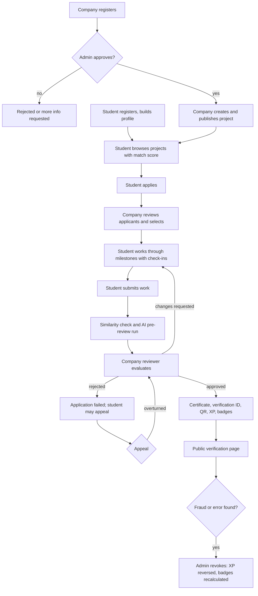
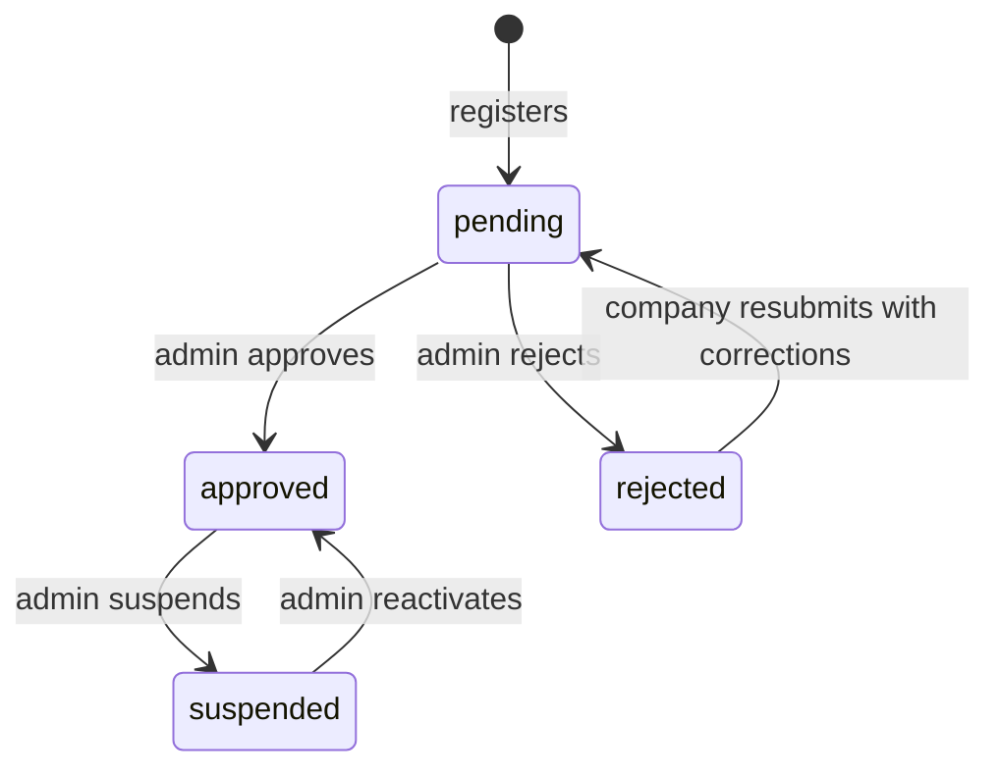
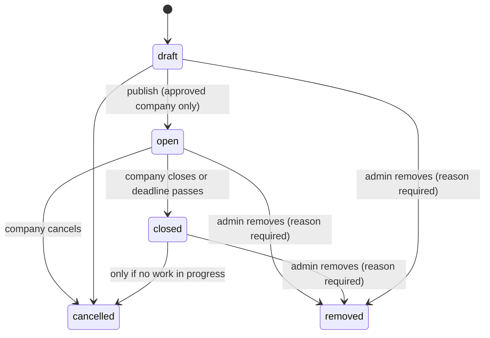
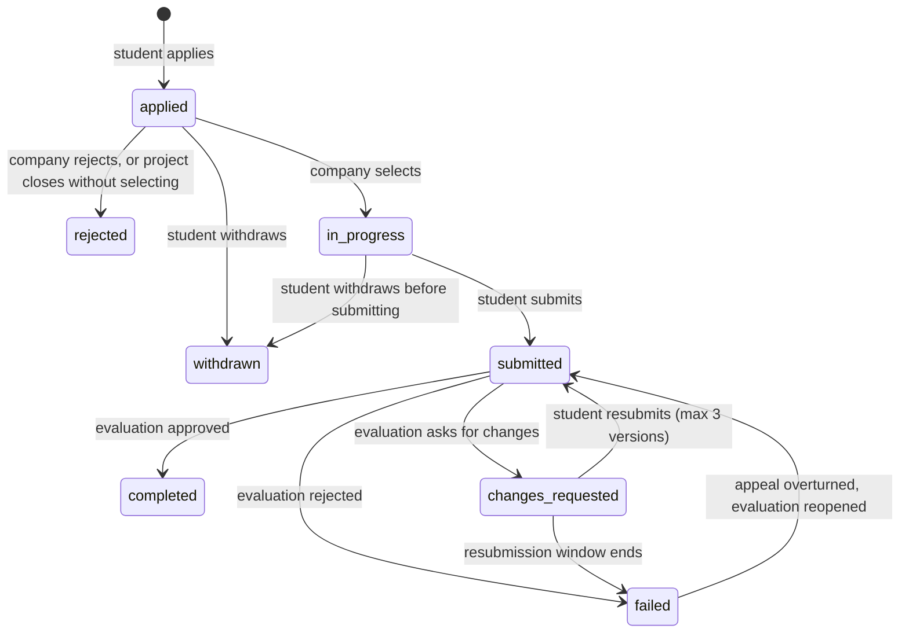
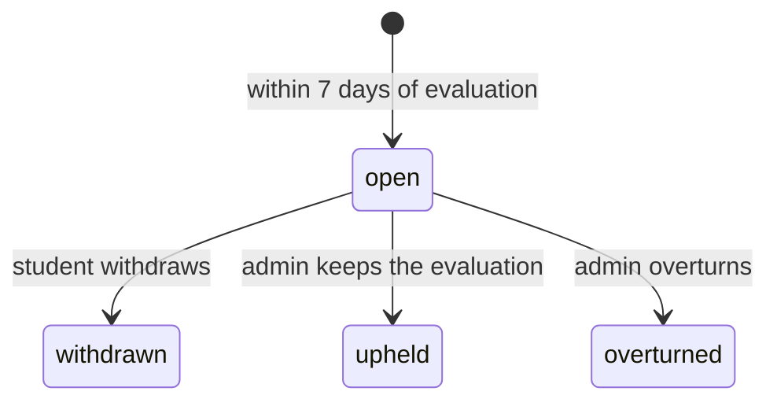
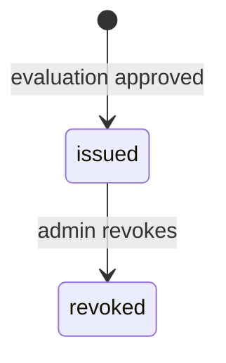

# ProjectProof AI: Workflows and State Machines

This document defines how things move through the system: who does what, in what order, and which status changes are allowed. The application must reject any transition not listed here. Table and status names match `schema.sql`.

## 1. Actors

Student, Company (owner or reviewer), Recruiter, Admin, Public visitor, and two system actors: the **Scheduler** (timed jobs) and the **AI service** (drafts only, never decides).

## 2. End-to-end flow

## 3. State machines

### 3.1 Company (`companies.status`)

Rules: only `approved` companies publish projects. Suspending closes all open projects and notifies applicants. Recruiters follow the same states.

### 3.2 Project (`projects.status`)

Rules: after the first student is selected, title, skills, difficulty, duration, milestones and company tasks are locked. A `closed` project keeps running for already-selected students. `removed` is set only by an admin, is final, and works as follows: the project leaves browse and search; `applied` applications become `rejected` and `in_progress` applications become `withdrawn`, each with `status_reason = project_removed`, no penalty and no XP either way; everyone affected is notified; certificates already issued from the project stay valid unless separately revoked.

### 3.3 Application (`applications.status`)

Rules: `completed` triggers certificate issue in the same transaction. `failed` and `withdrawn` earn no XP and no certificate. A student can hold at most 3 `in_progress` applications at once.

### 3.3a Task progress (`task_progress.status`, v2)
`todo` to `in_progress` to `done`, and back from `done` to `in_progress` while the application is `in_progress` or `changes_requested`. Tasks never block a check-in, a submission or an evaluation; they show progress. Company tasks cannot be edited after the first selection. A student's personal sub-tasks can be added or deleted until the application leaves `in_progress` or `changes_requested`.

### 3.4 Milestone check-in (`milestone_checkins.status`)
`submitted` leads to `accepted` or `needs_work`. A `needs_work` check-in is followed by a new check-in for the same milestone; the latest check-in counts.

### 3.5 Evaluation (`evaluations.decision`)
Created once per submission with `approved`, `changes_requested` or `rejected`. After creation only an upheld or overturned appeal can change the outcome, through an admin action that writes to the audit log. `approved` requires an overall score of 60 or more.

### 3.6 Appeal (`appeals.status`)

An overturned appeal reopens the submission so the company reviews it again, or, if the admin finds the evaluation clearly wrong, the admin can record a replacement decision.

### 3.7 Certificate (`certificates.status`)

`revoked` is final. If a revocation was a mistake, issue a new certificate through a new approved evaluation. The database blocks any other change.

### 3.8 Flag (`flags.status`)
`open` leads to `dismissed` or `confirmed`. A confirmed similarity flag normally leads the admin to revoke the certificate (if issued) or fail the application.

## 4. Use cases (step by step)

### UC-1: Company onboarding
1. Company owner registers and verifies their email.
2. Owner submits company details and a registration document.
3. System runs automatic checks: email domain matches website, document present, no other active company on the domain.
4. Admin sees the checks, approves, rejects or asks for more information. Every decision writes an audit log row and notifies the company.
5. Approved company gets trust score 50 and may publish up to 2 open projects until it has completed 3 evaluations.

### UC-2: Publish a project
1. Company opens "New project" and optionally uses the AI brief generator.
2. Company edits title, description, category, difficulty, duration, skills, milestones, number of students and deadline.
3. System computes `xp_max` and shows it read-only.
4. Company publishes. System checks company status and the new-company limit.

### UC-3: Apply
1. Student sees projects sorted by match score, each with its four-part breakdown.
2. Student applies with a cover note. System stores the match score and breakdown at that moment.
3. Alternate: student already applied (blocked), project closed (blocked), student already has 3 active projects (blocked with explanation).

### UC-4: Select applicants
1. Company opens applicants, optionally runs the AI ranking, filters and compares.
2. Company selects up to the project's limit. Each selection sets `in_progress`, `started_at` and `due_at`.
3. Students are notified. Unselected applicants are notified when the project closes.

### UC-5: Do the work
1. Student sees milestones with due dates (start date plus offset) and the tasks under each milestone; the student ticks task progress and may add personal sub-tasks.
2. Student posts a check-in per milestone. Company marks it accepted or needs work.
3. The scheduler flags overdue milestones daily and notifies both sides.
4. Optional: student asks the AI mentor for hints; each exchange is logged.

### UC-6: Submit and evaluate
1. Student submits a repository URL and/or file (version 1, 2 or 3).
2. A background job runs the similarity check and, if requested, the AI pre-review.
3. A similarity score at or above the high threshold opens a flag for admins; the company sees a notice that a review is pending.
4. Reviewer scores the rubric, writes feedback and a public summary, and decides.
5. On `approved`, the certificate transaction runs (see 03-tech-stack-and-architecture.md section 5).
6. On `changes_requested`, the student resubmits. On `rejected`, the student is told how to appeal.

### UC-7: Appeal
1. Student opens the evaluation and files an appeal with a reason within 7 days.
2. Admin reads the evaluation, submission and appeal, then upholds or overturns with a note.
3. Both sides are notified; the audit log records who decided and why.

### UC-8: Verify a certificate
1. Anyone scans the QR code or types the verification ID.
2. The server reads live data and returns the record or a not-found response.
3. The page shows Verified or Revoked, project, company, student name or initials, public summary, skills, timeline, time of check and the disclaimer.

### UC-9: Revoke a certificate
1. Company requests revocation with a reason, or an admin finds a problem directly (flag, appeal, report).
2. Admin chooses a reason category and writes a note.
3. One transaction: certificate becomes `revoked`, a negative XP event is added, badges are recalculated, the audit log is written, the student and company are notified.
4. The public page shows Revoked immediately.

### UC-10: Recruiter search
1. Approved recruiter enters a plain-text query or sets filters.
2. If plain text, the AI service returns a filter object; the recruiter sees it as editable chips and confirms.
3. Results include public students only. The recruiter opens a portfolio and follows links to verification pages.

### UC-12: Admin removes an inappropriate project (v2)
1. A user reports a project (manual flag) or the admin finds it while browsing `/admin/projects`.
2. Admin opens the project, reads the reason given, and removes it with a required reason.
3. One transaction: project becomes `removed`, `applied` applications become `rejected`, `in_progress` ones become `withdrawn`, the company trust score drops by 15, the audit log is written, the flag (if any) is marked confirmed, and notifications are created.
4. The company sees the reason. Certificates already issued are untouched.

### UC-13: Student portfolio and GitHub (v2)
1. Student links a GitHub username. The server reads the public profile and repositories through GitHub's public API and shows a summary labelled "self-linked, not verified".
2. Student may run the AI repo analysis, review each proposed skill and accept or edit them. Accepted skills are saved with source `self`.
3. The student's portfolio page lists verified projects. If the profile is public, recruiters see the same list with verification links.

### UC-11: Student deletes account
1. Student confirms with their password.
2. System anonymises the account as described in 02-database-schema.md section 9. Certificates remain valid and show "Former student".

## 5. Scheduled jobs

| Job | Frequency | What it does |
|---|---|---|
| Overdue milestones | Daily | Notifies student and company about overdue or due-soon milestones |
| Close expired projects | Hourly | Moves `open` projects past their deadline to `closed` and rejects unselected applicants |
| Resubmission window | Daily | Fails `changes_requested` applications past the window |
| Appeal window | Daily | Locks appeals older than 7 days |
| Token cleanup | Daily | Deletes expired refresh tokens |
| Data retention | Daily | Applies retention rules (AI logs, lookups) |
| Anomaly scan | Daily (stretch) | Runs the anomaly rules and opens flags |
| GitHub refresh | Weekly (optional) | Refreshes the public GitHub summary for linked students; skips silently on API limits |
| Trust score refresh | On events | Recomputes company trust score after evaluations, appeals and revocations |

## 6. Notification events

| Event | Recipient | In-app | Email |
|---|---|---|---|
| Application received | Company | yes | no |
| Selected | Student | yes | yes |
| Not selected | Student | yes | no |
| Milestone due soon or overdue | Student, company | yes | no |
| Submission received | Company | yes | no |
| Changes requested | Student | yes | yes |
| Certificate issued | Student, company | yes | yes |
| Appeal opened or resolved | Student, admin or student | yes | yes (resolved) |
| Company approved or rejected | Company | yes | yes |
| Flag opened | Admin | yes | no |
| Certificate revoked | Student, company | yes | yes |
| Project removed by admin | Company, affected students | yes | yes |
| Project reported | Admin | yes | no |

## 7. Concurrency and failure rules

- Selecting applicants locks the project row so two reviewers cannot exceed `max_selected`.
- Certificate issue locks the application row so a double click or retry cannot create two certificates (the unique constraint is the backstop).
- If PDF rendering or email fails after the transaction commits, the job retries; the certificate is still valid.
- If the AI service fails, the underlying action (apply, review, publish) still works without it.
- Every state-changing endpoint is idempotent when the same `Idempotency-Key` is sent.
